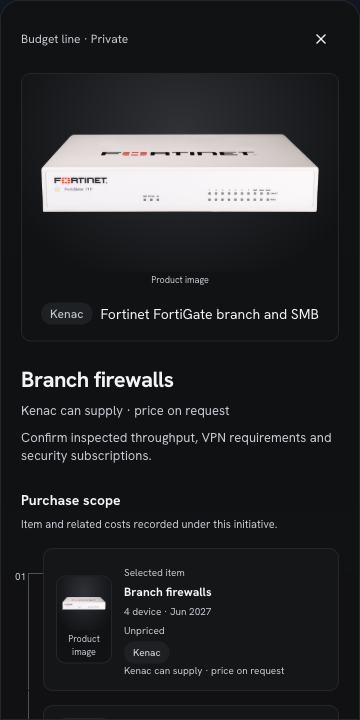

# T10 · Kenac catalogue

Continued the interrupted `bedce92` WIP, retaining its 39 product families and 23 official images. The supply catalogue is unpriced, loads through an in-memory reader in demo mode, and returns product metadata without usable prices or advisor price authorization. Solar/UPS now needs power-supplier quotes; the HUD adds branch firewalls, staff laptops, and switching/Wi-Fi. The integrator approved the renderer and stale HUD test scope extension. Cards, large detail visuals and recorded purchase parts now use the pure read-only catalogue lookup, with the Kenac badge and “Kenac can supply · price on request”. Existing image stages, tokens, dark HUD and reduced-motion behaviour are retained.

## Acceptance criteria

| Criterion | Result and evidence |
| --- | --- |
| ≥30 families across the requested categories, all unpriced, with factual sourced attributes and descriptions. | ✅ 39 families across all seven categories. CSV parsing and equality with the bundled JSON are tested. Price, currency and validity are blank/null for every family. Every family has a source in `sources.json`; unsupported model specifications remain unknown. |
| Every image has provenance on an allowed official domain; no logos used as photos, retailer images or people. | ✅ All 23 local files have unique provenance records. Visually reviewed every image in the contact sheet. Each is at least 400 px wide and below 1.5 MB. Fresh `curl` downloads match all original files byte for byte; SHA-256 hashes, actual format, dimensions and byte sizes are recorded. |
| Import accepts unpriced rows; `find_kenac_price` returns fitting unpriced products and never a usable price; tests cover both. | ✅ Import tests cover null prices, clearing previously sourced prices/evidence, and idempotence. A registry test checks product metadata, null usablePrice/price, empty authorization, and refusal of an invented `price_line`. Demo lookup works with an unavailable database URL. |
| HUD solar is unpriced and not Kenac; firewall, laptop and switching show official images with “Kenac can supply · price on request”; total excludes them. | ✅ Browser-verified FortiGate, ThinkPad T-series and Meraki MS photos, Kenac badges and exact supply copy. Solar uses the Power illustration with no Kenac association. All four remain unpriced and contribute no money when accepted; the HUD says “Awaiting prices”. The detail sheet retains unpriced evidence and explicitly asks to confirm family specification, availability and fit. |
| All five required commands pass. | ✅ All five pass: 259 unit tests in 51 files, 62 eval tests in six files, typecheck, lint and production build. The approved three HUD test files now reflect the unpriced solar/equipment demo. Engine totals, unknown-value checks, Kenac labels, sourcing fit gate and reduced-motion assertions remain enforced. |
| Report includes a one-page contact sheet and reasons for families without images. | ✅ Contact sheet below lists every local image with its family name. All 16 missing images and their reasons are documented in the catalogue README. |

## Contact sheet

[Catalogue documentation and missing-image reasons](../../../catalogue/kenac/README.md). Missing-image families: Lenovo docks, IBM Power, Meraki AP/MX, F5 BIG-IP, BeyondTrust, Guardium, Verify, MaaS360, Microsoft 365, vSphere, MQ, App Connect, Veeam, NetBackup, and Cloudera. These use the T9 category illustrations. Software visuals were omitted where no suitable clean product UI/visual was retained; logos and decorative imagery were excluded. Hardware omissions reflect unavailable clean representative imagery on the reviewed family pages.

## Verification and scope

- `pnpm test`: 259 passed in 51 files. New render coverage checks official family images, exact supply copy, Kenac badges, unchanged plan data, no zero-valued unpriced budget, preservation of sourced imagery and own-estimate isolation.
- `pnpm test:evals`: 62 passed in six files, without live model calls.
- `pnpm typecheck`: passed with Next-generated layout types.
- `pnpm lint`: passed.
- `ADVISOR_MODE=demo ADVISOR_DEMO_HUD=1 SESSION_STORE=memory DATABASE_URL= OPENAI_API_KEY= pnpm build`: passed. No database or model key was used.
- `git diff --check`: passed.
- No dependencies, frozen contracts, price-evidence policy, money engine, Prisma schema or shared application files changed. Default demo fixture remains unchanged; only the HUD script changed.
- No Postgres or live OpenAI calls were used. The database importer was exercised through its stateful transaction double; a live import remains an environment-dependent integration check.
- Local commits only; no remote exists and nothing was pushed. The port-3211 dev attempt failed with the environment’s Turbopack “unable to start FSEvent stream” error. Browser QA used the passing production build on port 3211. The server was stopped and `lsof` confirmed the port is free.

Manufacturer pages were reviewed directly. NetBackup's original Veritas page now redirects to [Cohesity](https://www.cohesity.com/platform/netbackup/), so its description asks for channel/entitlement confirmation. VMware's subscription transition is supported by [the vendor's licensing notice](https://blogs.vmware.com/cloud-foundation/2024/01/22/vmware-end-of-availability-of-perpetual-licensing-and-saas-services/). Legacy Dell OptiPlex/Latitude images remain representative family visuals; model and current-equivalent confirmation are explicit. Read-only associations illustrate possible supply and never assert fit or enter pricing evidence.

## Browser verification

Checked the production demo at 1440×1000 and 360×800 in light and dark mode. All three official images loaded (FortiGate: 1000 px; ThinkPad: 2000 px; Meraki MS: 650 px), with existing contain framing and captions. Desktop detail content measured 479 px client/scroll width; phone detail and plan panel measured 358 px client/scroll width within the 360 px viewport. Supply copy wraps without horizontal overflow. Escape closes the nested detail sheet and leaves the mobile plan available. Browser console had no warnings or errors.

Accepting solar and the three equipment lines leaves the canonical total at 0.00 and the visible headline at “Awaiting prices”; accepting the two explicitly illustrative priced lines yields US$5,640 so far. In reduced motion, increasing the firewall quantity from four to five leaves spend unchanged. Entering US$125.25 as an own estimate removes the supply photo, Kenac badge and price-on-request copy for that line, preserves “Own estimate”, and synchronously shows US$626.25 for the line and US$6,266.25 so far overall. No running animations were observed.

[Desktop light](T10-assets/desktop-light.png) · [Desktop dark](T10-assets/desktop-dark.png) · [Phone light](T10-assets/phone-light.png) · [Phone dark](T10-assets/phone-dark.png)

## Manual test script

1. Run `ADVISOR_MODE=demo ADVISOR_DEMO_HUD=1 SESSION_STORE=memory DATABASE_URL= OPENAI_API_KEY= APP_URL=http://localhost:3211 pnpm dev --port 3211`, then open `http://localhost:3211/?demo` in a fresh session. If the environment’s file watcher fails, run the build command above and use the same demo variables with `APP_URL=http://localhost:3211 pnpm start --port 3211`.
2. Send “180 staff, four new branches; the board wants fewer outages”, then “Mostly power; ZESA cuts”. Check that solar/UPS remains Unpriced, uses the power illustration and has no Kenac association. Advisor copy requests power-supplier quotes.
3. Check the branch firewalls, laptops and switching/Wi-Fi visuals against FortiGate SMB, ThinkPad T-series and Meraki MS. Each must show “Kenac can supply · price on request”. The switching note clarifies that access points require separate scoping. Accept these four unpriced lines: canonical spend stays at zero, the visible headline remains “Awaiting prices”, and four accepted lines remain unpriced.
4. Accept the two illustrative priced lines: total becomes US$5,640 so far. Evidence labels must remain “Demo price list · not real prices”. Open a family detail sheet, confirm the representative-family fit caveat, then request a quote.
5. Repeat at 360px, desktop width and in both themes. Confirm images fit their existing stages and the supply label wraps without horizontal overflow. Enter a user estimate on an equipment line: the own-estimate evidence must remain intact, with no fabricated operator price.
6. Stop the server on port 3211 before finishing.
