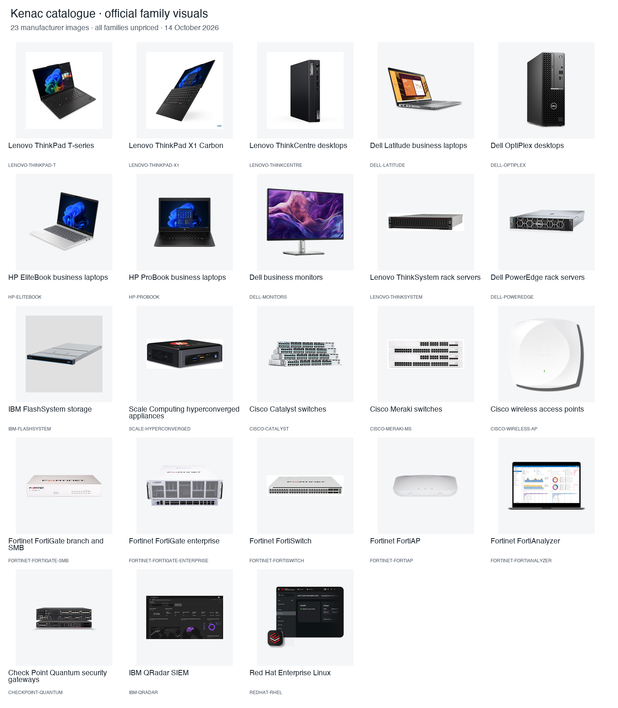

# T10b · Kenac catalogue image quality

Replaced the FortiSwitch, FortiAP, FlashSystem and Scale visuals with official hardware photographs. Trimmed the ProBook's transparent margins so the device occupies 80% of its canvas width. The 23-image contact sheet now uses equal square contain stages with 10% padding, making the family visuals directly comparable to line cards.

## Acceptance criteria

| Criterion | Result and reason |
| --- | --- |
| The five families have official hardware product shots, or a documented reason. | ✅ All five have suitable hardware shots; no exception needed. Fortinet supplies switch/AP photos through its official press-kit ZIPs, HP retains its official ProBook photo with a margin-only crop, IBM supplies a single FlashSystem enclosure, and Scale supplies an HE150 appliance photo. Details below. |
| The regenerated contact sheet looks like one curated set. | ✅ Visually reviewed all 23 images together in equal square stages. The two misleading Fortinet laptop screenshots, Scale screenshot and IBM banner are gone; ProBook now has comparable visual weight to the other laptops. Hardware uses plain white, transparent or light-grey backgrounds. Permitted software screenshots remain in the same contain framing. |
| Provenance is complete for every replaced image. | ✅ All five records include the official source page, download URL/date, vendor and partner-use licence note, plus actual dimensions, format, byte count and SHA-256. Fortinet records identify ZIP members. All three margin crops include original dimensions/hash and exact crop coordinates; stored pixels were checked against the corresponding source crops and match exactly. |
| `pnpm test`, `pnpm typecheck`, `pnpm lint` and `pnpm build` pass. | ✅ 259 tests pass in 51 files, including provenance, CSV/JSON parity and image rendering coverage. Typecheck, lint and production build pass. Demo mode uses in-memory sessions, an empty database URL and no OpenAI key. |

## Image changes

| Family | Official source and selected image | Stored file |
| --- | --- | --- |
| FortiSwitch | [Fortinet press kit](https://www.fortinet.com/corporate/about-us/newsroom/press-kit), `FortiSwitch.zip` → `FS-648F-FPOE.png`. Trimmed plain white vertical margins, preserving the complete switch. | PNG, 2280 × 620, 703,255 bytes |
| FortiAP | [Fortinet press kit](https://www.fortinet.com/corporate/about-us/newsroom/press-kit), `FortiAP.zip` → `FortiAP-441K.png`. Trimmed transparent margins, preserving the complete access point and its shadow. | PNG, 1220 × 440, 296,861 bytes |
| HP ProBook | [HP ProBook family page](https://www.hp.com/us-en/laptops/business/probooks.html), existing `media@2x.png`, freshly downloaded. Cropped the 1520 × 358 source to `(526, 0, 994, 358)`; the device's 374-pixel width fills 79.9% of the resulting canvas. | PNG, 468 × 358, 34,355 bytes |
| IBM FlashSystem | [IBM FlashSystem 5600](https://www.ibm.com/products/flashsystem-5600), official `flashsystem_5600_iso_wbackground_g20.png` JPEG rendition. A single three-quarter enclosure photo on light grey; downloaded bytes retained. | JPEG, 1280 × 1280, 65,566 bytes |
| Scale hyperconverged appliances | [Scale's HE150 article](https://www.scalecomputing.com/blog/the-he150-small-footprint-big-possibilities), official `HE150` PNG. A physical HyperCore appliance on white; downloaded bytes retained. | PNG, 672 × 260, 190,803 bytes |

The exact image/download URLs are in [images.json](../../../catalogue/kenac/images.json). The photos represent product families; they do not establish model-level fit, current availability or a price. Original image formats are retained. No product pixels were retouched, resized or generated.

## Verification

- `ADVISOR_MODE=demo SESSION_STORE=memory DATABASE_URL= OPENAI_API_KEY= pnpm test`: 259 passed in 51 files after the final asset changes.
- `pnpm typecheck`: passed.
- `pnpm lint`: passed.
- `ADVISOR_MODE=demo ADVISOR_DEMO_HUD=1 SESSION_STORE=memory DATABASE_URL= OPENAI_API_KEY= pnpm build`: passed with all 15 pages generated. The final FortiAP change is a public file replacement, served directly without bundling.
- `python3 catalogue/kenac/render_contact_sheet.py`: verified hashes, actual image formats, dimensions and sizes for all 23 files, then regenerated the sheet. Every image is at least 400 pixels wide and below 1.5 MB. Uses the existing Pillow installation; no dependency added.
- Production runtime on port 3212: all 23 image URLs returned HTTP 200, image content types and bytes matching the provenance hashes. The opening page returned 200 with Kenac disclosure. Two demo turns completed without error, with 3 and 13 plan operations, using one in-memory session and no database or model calls.
- Source review confirmed hardware and software share `.bb-hud-visual-stage`, `object-fit: contain`, square card stages, 10% padding and the existing dark-mode treatment. No renderer changes were necessary. Visual QA used the regenerated contact sheet; a new browser-based phone/dark-mode pass was not performed in T10b.
- `git -c core.whitespace=cr-at-eol diff --check`: passed, respecting the existing CSV's CRLF endings.
- The port-3212 server was stopped after runtime checks. No remote exists and nothing was pushed.

## Scope and T8 integration

All changes stay within `public/catalogue/kenac/**`, `catalogue/kenac/**` and this report. No shared application files, dependencies, frozen contracts, prices, plan operations or model configuration changed.

Scale's image format is now PNG, so `products.csv` and `products.json` both reference `/catalogue/kenac/scale/SCALE-HYPERCONVERGED.png`. The obsolete screenshot WebP is removed. The bundled demo needs no additional setup. If T8 uses a previously imported database catalogue, refresh that persisted Scale image URL through the catalogue import workflow. No schema or migration is required. T8 should include the visual checks below in its normal cross-device integration pass.

## Manual visual test script

1. Build using the demo command above, then run `ADVISOR_MODE=demo ADVISOR_DEMO_HUD=1 SESSION_STORE=memory DATABASE_URL= OPENAI_API_KEY= APP_URL=http://localhost:3212 pnpm start --port 3212`. Open `http://localhost:3212/?demo` in a fresh session and complete the first two scripted turns. Check that the existing firewall, laptop and switching photos still load with Kenac disclosure and price-on-request labels.
2. Open the contact sheet and compare the five changed families: switch, access point, full-size laptop, single FlashSystem enclosure and Scale appliance. Confirm no hardware family depicts management software. FortiAnalyzer, QRadar and RHEL should retain their software visuals.
3. At 360px and desktop width, in light and dark mode, check equipment cards and their detail sheets: images remain contained, captions wrap without overflow, and the product is fully visible. Use the five manifest paths to check the replacements directly when those families are not present in the scripted demo.
4. Stop the server and confirm `lsof -nP -iTCP:3212 -sTCP:LISTEN` has no output.
