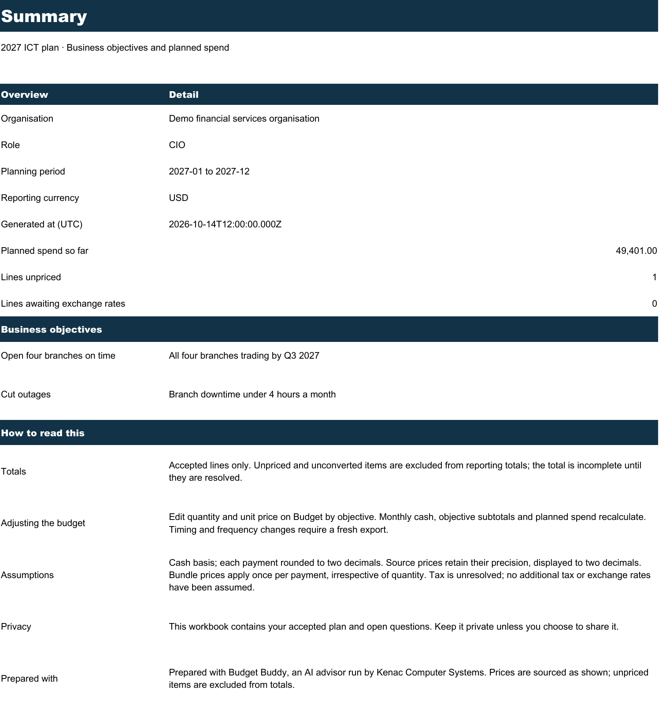
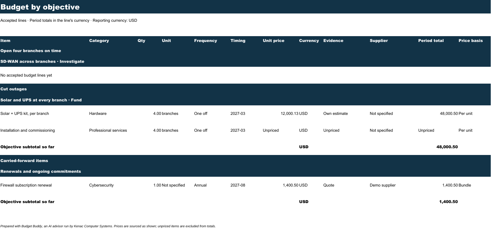
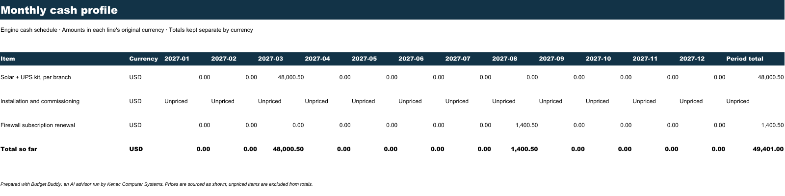
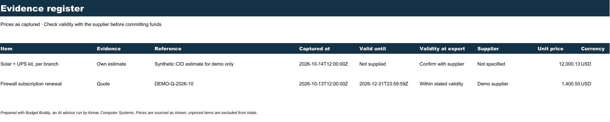
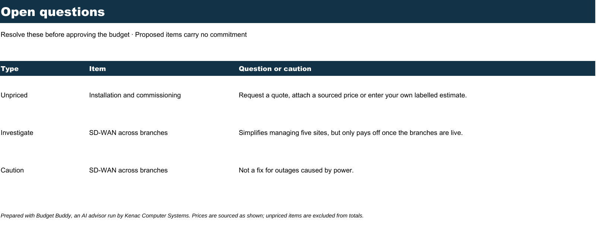

# T5: Excel export and per-line sharing

Budget Buddy exports a five-sheet ICT workbook with business objectives, editable budget inputs, formula subtotals, monthly cash, evidence and open questions. Users can preview the exact per-line disclosure before sharing. The protected Kenac HTML and CSV views re-read current consent and omit private lines, contact details and allocations unless expressly allowed.

Branch: `codex/T5-export-and-sharing`. Local commits only; no remote or push. Frozen contracts, Prisma schema and other agents' production files are unchanged. The pre-existing, allowed ExcelJS installation changes in `package.json` and `pnpm-lock.yaml` are included. No other dependency was added.

## Acceptance criteria

| Criterion from the brief | Result and evidence |
| --- | --- |
| The workbook opens cleanly in Excel and LibreOffice. Formulas recalculate. Unpriced is never 0. Grouping and subtotals are correct; golden demo sheet-values snapshot. | ❌ Partially verified: LibreOffice 26.2 opened and rendered all five sheets cleanly. A changed quantity and newly entered price recalculated the summary from USD 49,401.00 to USD 68,401.23, and unpriced count from 1 to 0, without formula errors. Golden values include every sheet, formulas, cached results, objective/initiative grouping and Unpriced strings. Native Excel inspection remains for T8: the computer-use tool did not allow access to Excel, so it has not been claimed as tested. |
| Proposed or dismissed items are excluded from totals. | ✅ Tests change priced accepted lines to proposed/dismissed and verify their removal from budget, cash and evidence, plus the reporting total. Proposed items appear only as “Not yet decided” on Open questions. Accepted lines remain visible when a parent is undecided, under a neutral awaiting-agreement heading; the parent's proposed content stays on Open questions. |
| The preview matches the Kenac view row for row (test). | ✅ One validated `sharedRows` projection supplies the preview, server response, Kenac table and CSV. Mixed fixtures verify quantities, timing, notes, allocation consent, separate contact consent and assigned sharing dates. Route tests compare confirmed preview rows with HTML fields and the complete CSV bytes. Before confirmation, dates are explicitly described as recorded on confirmation. |
| Unsharing removes the line from `/kenac` immediately. | ✅ Memory and route tests revoke through `applyOp`, update the live session and read the protected view without refreshing the index; the line disappears. The runtime HTTP smoke also verified immediate removal. Views never serve a cached disclosure snapshot. |
| `/kenac` without the token returns 401; it never shows unshared data, tested with a mixed fixture. | ✅ Real 401 responses for both HTML and CSV. Missing, incorrect, short and query-string tokens fail closed. Mixed fixtures exclude other lines, the conversation, plan structure, hidden allocations and contact details. Cookie signature, tampering, expiry, token rotation, secure production flags, CSRF, chunked body limits and HTML/CSV injection are tested. |
| Screenshots of each sheet in the PR. | ✅ All five final sheets were rendered with LibreOffice, inspected and embedded below. |

## Verification

- T5: **26 passing tests**, including the real T3-to-T5 attachment integration, golden workbook values, privacy projections, protected routes and mocked Prisma audit persistence.
- `pnpm test`: **168 passed, 1 failed**, 38 test files. The sole failure is T3's `feature-detects the absent workbook module and sends the export link`: T5 now supplies the module, so email correctly attaches the workbook instead of taking the absent-module fallback. The fallback is already injectable. A small, checked [test patch](T5/email-test-fix.patch) makes that test pass `buildWorkbook: null` explicitly and renames it accurately. Applying it is pending the requested exception to strict file ownership. T3's test and production code have not been changed.
- `pnpm typecheck`: passed after `pnpm exec next typegen` generated this Next.js version's route/layout helpers.
- `pnpm lint`: passed. `git diff --check`: passed.
- Final `pnpm build`: passed with `DATABASE_URL=` and `ADVISOR_MODE=demo`. No OpenAI key or new model ID is involved. Model configuration remains with T1's `OPENAI_MODEL`.
- Runtime HTTP smoke on port 3205: first reply, accepted ops, evidenced own estimate, save without SMTP, XLSX download, owner preview, protected HTML/CSV, withdrawal and signed login cookie all passed against T3's memory store. A temporary T5-owned demo-turn adapter injected the T3 store because the current T1 route still defaults to its separate memory store. The adapter and the temporary panel preview page were removed before committing. No mail was sent or external Kenac service contacted.
- Chrome production rendering: sharing panel inspected at 360px in light/dark mode and desktop in dark mode. Document width and scroll width were both 360px. Allocation starts unchecked; local preview omits it until selected, then shows the sourced period total. Contact details stay absent without contact consent. The Kenac login form and protected table were inspected. Browser theme and viewport were restored.
- Automatic approval review rejected the browser's final “Share” click, treating it as disclosure without authorization for that payload and recipient. It was not retried through another path. Browser checks continued with local preview only; confirmation/revocation had already passed the HTTP smoke and are covered by automated route tests.
- LibreOffice used an isolated temporary profile with OOXML recalculation enabled. The reproducible [workbook review script](T5/review.ts) generates originals/edited copies in `/private/tmp/budget-buddy-T5-review` and verifies cached values after LibreOffice recalculation. The [HTTP smoke script](T5/smoke.mjs) defaults to the integrated `/api/advisor/turn`; `T5_TURN_PATH` can select a temporary injected-store test route.
- All task-started servers were stopped. Nothing listens on port 3205.

## Implementation details for reviewers

`buildWorkbook(plan, {organisation?, role?, generatedAt?})` returns `Promise<Buffer>`, compatible with T3's email builder signature. The cookie-authenticated download is `/api/export/xlsx`, named `ICT-plan-2027.xlsx`. Saved metadata is included only for a saved session. Summary and open-question counts distinguish unpriced and unconverted lines. Currency subtotals remain separate; no FX or tax amounts are invented.

Quantity and unit price on Budget by objective are the editable inputs. The monthly schedule comes from the engine, with spreadsheet formulas that round each payment and feed objective subtotals, summary spend and unpriced count. Bundle quantities never multiply a bundle price. Timing/frequency edits require a new export, explained in the workbook. Decimal values become Excel numbers only at serialization. Source unit-price precision is retained, shown in cell notes and explained in the summary; displayed money uses `#,##0.00`.

Sharing uses only `set_sharing` through `/api/plan/op`. After those operations, `POST /api/share` with `{}` records dates and returns the confirmed projection; it does not edit the plan. Dates are persisted as ids and consent flags in the existing `AuditEvent` table. No schema change or migration is needed. The database adapter selects saved sessions without selecting messages or return tokens. Memory mode indexes sessions at confirmation, then resolves them through the live shared store on every view. It is local demo storage and does not survive restarts or span replicas.

`/kenac` uses a no-JavaScript Route Handler so unauthorised requests have a genuine HTTP 401 without changing T6's config to enable experimental auth interrupts. It uses the Humaflow source tokens, supports system dark mode, escapes all shared content and applies the CSP nonce. `/kenac/csv` uses the same projection, quotes fields, and neutralises spreadsheet formula injection. Each successful HTML/CSV view logs only its event type and row count.

## T8 integration

1. **Share one session store across T1/T3/T5.** Register T3's `getSessionStore` with T1's `registerSessionStore` and select it via `SESSION_STORE=shared`, as T1's report describes. T5 already imports `@/lib/session` and its cookie helper. Until this is wired, a session created by T1's default separate memory provider cannot be opened by T3/T5 routes.
2. **Mount the sharing panel.** Add `<SavedSharePanel onPlanChange={setPlan} />` from `@/components/advisor/share-panel` after a successful save and when a saved user requests sharing. It fetches the owner's saved context itself; the advisor parent need not retain contact details. Alternatively, controlled `<SharePanel plan={plan} contact={contact} saved={saved} onPlanChange={setPlan} />` is exported. The parent advisor screen/save form are outside T5 ownership, so these mounting changes are left for T8.
3. **Keep all share entry points in sync.** The supplied panel confirms via `POST /api/share` after its sequential `/api/plan/op` requests. If T8 adds another sharing control, call that confirmation endpoint too, or call `recordSharing` server-side after successful sharing ops. This captures share dates and indexes memory sessions. Production saved-session discovery and revocation read current database state even without the index; older shares without an audit event show their date as not recorded.
4. **Resolve the obsolete T3 email test.** Apply the checked patch after authorising the cross-owned test change, then rerun `pnpm test`. The new T5 attachment integration already verifies T3 discovers the real builder and attaches a readable workbook with saved organisation/role; the production email module needs no change for that behaviour.
5. **Run against Postgres and real delivery.** Apply T3's existing migrations and verify saved-session discovery, audit dates, consent withdrawal and restart behaviour against a real database. The Prisma path is mocked here because Postgres is unavailable. Verify real SMTP attachment delivery after the shared-store integration.
6. **Configure the Kenac view.** Set `KENAC_VIEW_TOKEN` to a randomly generated base64url secret, 32–512 characters. An unset/invalid value fails closed. Supply it in `Authorization: Bearer …` or use the login form once for an eight-hour httpOnly cookie, scoped to `/kenac`, SameSite Strict and Secure in production. Rotating the token invalidates existing login cookies. No credential belongs in a query string.
7. **Finish application acceptance.** Open the exported workbook in native Excel, check recalc after editing quantity/price, and repeat the integrated wrap-up/sharing journey on a phone and laptop. A human can perform the final browser confirmation if desired; automated approval review prevented that one manual click during this run.

## Manual test script

1. Start the integrated app on port 3205 with `DATABASE_URL=` and `ADVISOR_MODE=demo`, and a local test `KENAC_VIEW_TOKEN`. Confirm unauthenticated `/api/export/xlsx`, `/kenac` and `/kenac/csv` return 401. Confirm the Kenac login accepts only the configured token and offers sign-out.
2. Complete the two demo turns, accept objectives/initiatives/lines, price one line with a labelled own estimate and leave another unpriced. Save synthetic contact details with contact consent unticked. Download the workbook and check five sheets, objectives, evidence, unpriced labels, monthly cash and incomplete totals. Edit quantity/price; confirm cash, objective subtotal, summary spend and unpriced count recalculate.
3. Open sharing at 360px and desktop in light/dark mode. Select one accepted item. Check that “Include my budget for this item” is unticked, preview omits the amount and all contact details, and no horizontal document overflow appears. Tick the allocation option; verify the period amount appears only for that row.
4. With the tester's authorisation, confirm sharing and compare preview with the protected table/CSV. Confirm other lines, the conversation and plan structure never appear. Untick sharing and confirm; refresh the Kenac view and verify immediate removal. Repeat with separate contact consent true, then withdraw it and confirm names/organisation disappear.
5. Open and edit the workbook in native Excel and LibreOffice. Configure a controlled SMTP mailbox, save again, and verify the readable XLSX attachment. Stop the server.

## Sheet screenshots

Summary:

Budget by objective:

Monthly cash profile:

Evidence register:

Open questions:

