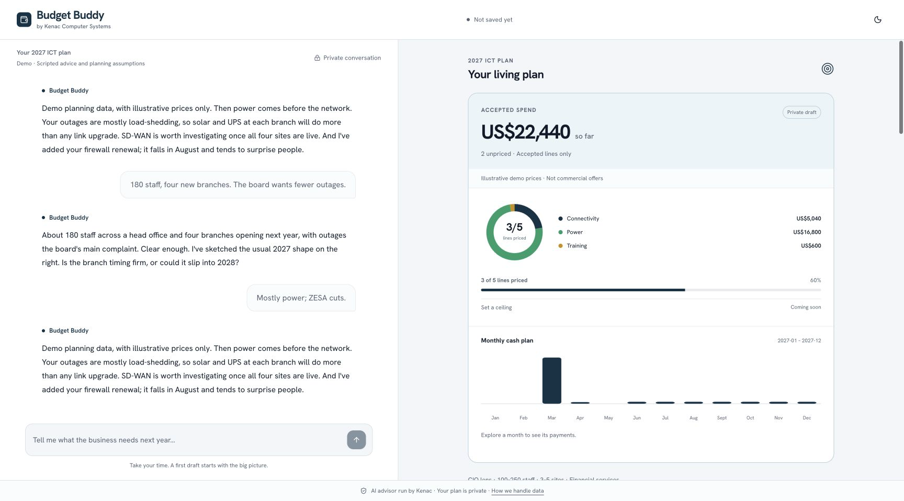
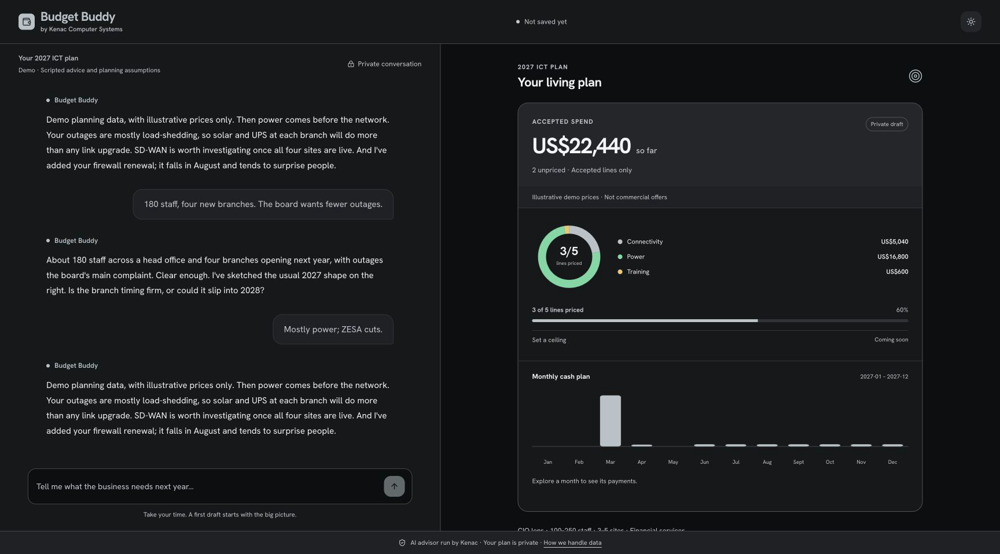
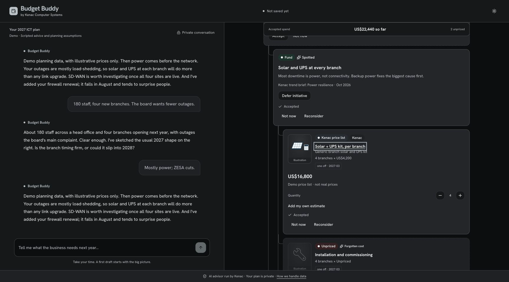
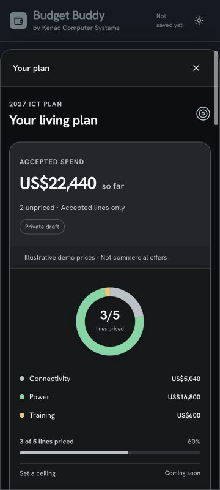
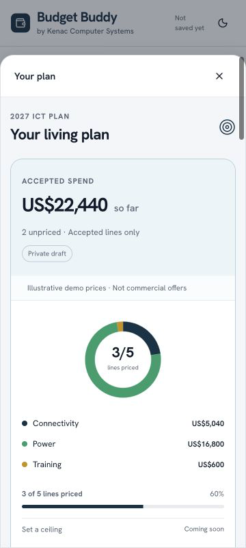
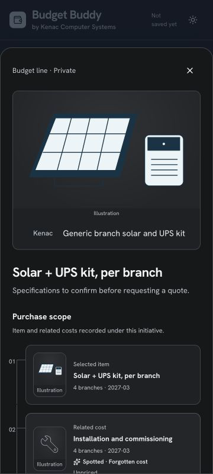
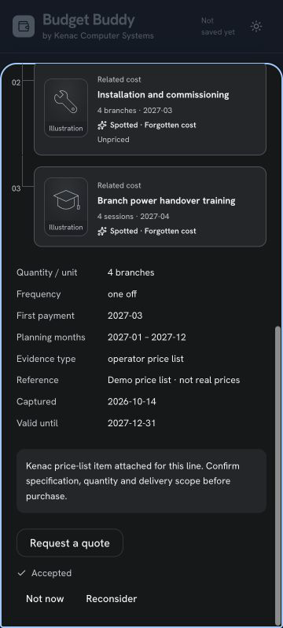
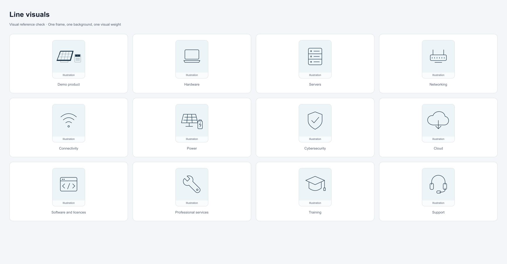
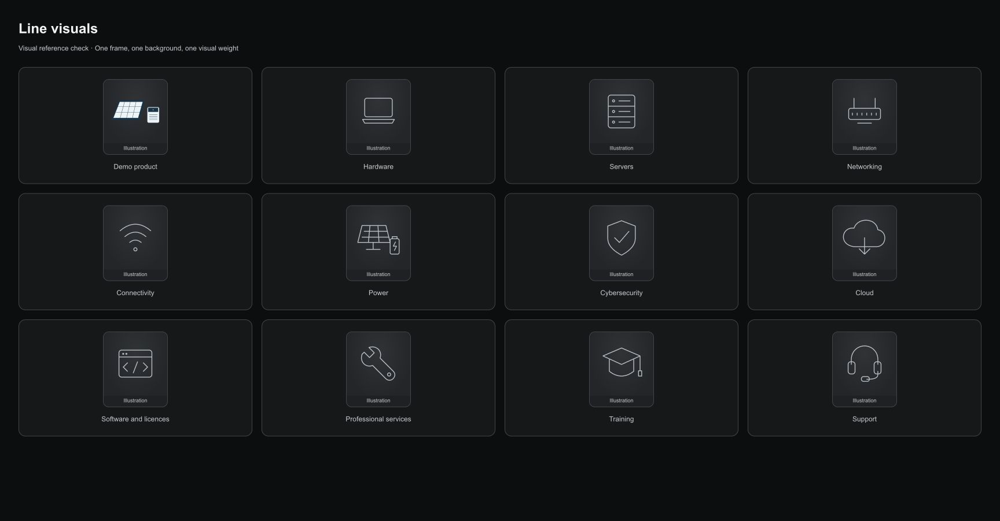
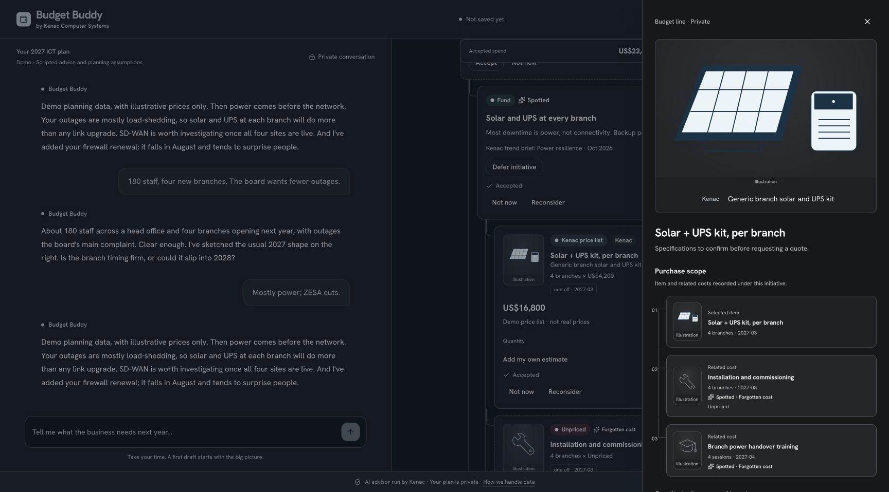

# T9 · Interactive plan HUD

The living plan now connects business objectives to initiatives and budget lines. Accepting, pricing or changing a quantity updates the spend, category ring and monthly cash profile. Fund/Defer previews the financial effect of a decision while retaining the recorded lines. Proposed items stay readable; set-aside items move into a restorable group.

Line cards use a consistent set of eleven original category SVGs and a generic solar/UPS product render. The detail sheet provides evidence, specifications, recorded purchase parts, forgotten-cost markers and a neutral clipboard quote request. Product images remain attached to sourced prices through the pricing tool and plan reducer.

Branch: `codex/T9-plan-hud`. No push or remote PR. Code commits: `53b2392` (catalogue images), `9070204` (HUD demo fixture), `6dc845c` (HUD and detail sheets). No dependencies added. Frozen contracts and the calculation engine are unchanged. The only shared-file change is an additive nullable `CatalogueItem.imageUrl` in `prisma/schema.prisma`.

## Acceptance criteria

| Criterion | Result and evidence |
| --- | --- |
| In demo mode, a full run shows items flying in during the reply, the Spotted glow, the total counting up on accept, the ring and timeline animating, a Kenac product photo on a priced line, and illustrations on the others. | ✅ Verified with `ADVISOR_MODE=demo ADVISOR_DEMO_HUD=1`, an in-memory store and no OpenAI key. Five lines across five categories, three documented demo prices, a generic Kenac-labelled product illustration, proactive power and firewall catches, and installation/training markers. The recording shows streamed turn 2, accepts and deferral. SVG product imagery is explicitly labelled “Illustration”; all demo prices say “Demo price list · not real prices”. |
| Fund ↔ Defer changes the total, ring and timeline, and shows “Deferring saves US$X”; all amounts come from `planTotals`. | ✅ `update_initiative` is user-allowed. The existing optimistic user-op path persists the disposition through `/api/plan/op`. The view filters lines belonging to accepted deferred initiatives before calling `planTotals`. The checked example changes US$22,440 to US$5,040 and saves US$17,400. Unit tests cover reversal, unchanged stored lines, category/objective reconciliation, custom periods, unknown quantities and exchange-rate gaps. |
| Proposed items are fully legible, with contrast ≥ 4.5:1 and an “Awaiting your decision” chip; set-aside items are grouped and restorable. | ✅ Full-contrast text, dashed brand borders and decision chips. Sampled light-mode proposal headings, body text and chips have a minimum contrast of 6.32:1 across 19 samples. Dark-mode titles were measured at 16.30:1. Path emphasis dims imagery/backgrounds rather than fading proposal text. Set aside and restore were checked in the browser. |
| The detail sheet works with the keyboard and on a phone; “Request a quote” copies the text. | ✅ Native modal dialog, explicit Tab wrapping, Escape, restored trigger focus and an Enter/Space card shortcut. At 360px the drawer becomes a bottom sheet. Shift+Tab from Close wraps to the final action; Escape closes the detail sheet while keeping the outer mobile plan open. Clipboard write returns “Copied”. Purchase scope lists the actual kit, commissioning and training lines, with two Spotted markers. |
| Reduced motion: no movement, and final states are correct. | ✅ CSS disables HUD, drawer, button and screen animations/transitions. The Decimal total updates directly when reduced motion is enabled, including changes to the media preference. Browser verification found zero running animations after quantity/funding changes. |
| The price-list import accepts optional `image_url`; `find_kenac_price` returns the product; a test shows a Kenac-priced line keeps `product.imageUrl` through `price_line`. | ✅ CSV tests cover local/HTTPS images, blanks and rejected unsafe schemes. Import tests check persistence and clearing. The stubbed agent → memory store test checks lookup → `price_line` and preservation of the image URL. A database-free migration diff generated the single additive SQL column. |
| `pnpm test`, `pnpm test:evals`, `pnpm typecheck`, `pnpm lint` and `pnpm build` pass. | ✅ 237 unit tests in 45 files; 62 eval tests in 6 files; typecheck, lint (no warnings) and production build pass. Build uses demo mode, an empty `DATABASE_URL`, and no OpenAI key. The eval command runs the local eval test suite; live model judging requires T8's configured account/key. |
| The report includes desktop light/dark and phone screenshots, plus a short recording of turn 2, accept and defer. | ✅ Links and previews below. Recording duration: 10.83 seconds; idle gaps are shortened. Screenshots were rendered and visually reviewed; the 360px page and panel have no horizontal overflow, including after quantity and own-estimate edits. |

## Visual evidence

[Watch turn 2, accept and defer](T9-assets/turn-2-accept-defer.webm)

The product owner's mid-task `docs/codex/T9-visual-references.md` addendum was read and applied: consistent object framing and padding, immediate optimistic feedback, a large detail visual, a connected purchase-parts list and restrained dark mode. Assets are original SVGs. The [Ubiquiti store](https://store.ui.com/us/en) and [Framework](https://frame.work/) were reviewed as imagery/modularity references; no assets, logos, product claims or prices were copied. The owner-created untracked addendum is left intact and is not included in these commits.

## Visual references pass

Focused follow-up polish, 14 October 2026. Read the product owner's reference addendum and checked all four concrete requirements against the running demo in Chrome.

- Replaced baked-in pale SVG backgrounds with a shared image stage. Photos use `object-fit: contain`; category SVGs use alpha masks tinted by the active Humaflow brand token. Every small stage has the same square aspect ratio, 10% inner padding, neutral background and reserved caption. The generic product render has tighter object framing. Dark mode uses token-based charcoal lighting, with clear outlines and illuminated product surfaces.
- The total takes its first eased step in a layout effect before paint, then continues towards the engine's target for about 600 ms. Ring and bar updates retain visible geometry rather than restarting the bars from zero. A compact spend strip stays visible while the leader edits further down the tree. Reduced motion writes the final total synchronously and schedules no animation frame; CSS disables motion throughout the advisor screen.
- The detail sheet separates the selected purchase and related costs into numbered, connected pieces. Installation and training are highlighted as Spotted costs. It shows only recorded lines; missing accessories or disposal costs are not invented.

| Concrete reference check | Result |
| --- | --- |
| Put every illustration/product visual side by side: one curated set. | ✅ Reviewed the demo product beside all eleven category illustrations in light and dark mode. The twelve enlarged contact-sheet stages all measured 110 × 110 px, with 11 px padding and the same background. Their production card and part stages use the same component and proportions. |
| Every toggle/stepper updates total, ring and timeline within one frame, with an eased number response. | ✅ Exercised all three initiative toggles, both directions of all five quantity steppers, and priced-line accepts. All 22 sampled operation commits measured 2.7–15.8 ms. For every operation that changed accepted priced spend, the canonical total, displayed number, ring and timeline had changed at the first animation-frame check. Unpriced and informational bundle quantities correctly leave spend unchanged; their cards update without fabricating amounts. These timings are measurements of this demo on this machine, rather than a guarantee for arbitrarily large plans. |
| Detail sheet has an exploded parts list with forgotten costs highlighted. | ✅ The solar purchase shows three recorded pieces: kit, commissioning and training. Two rows carry Spotted/forgotten-cost markers. The phone modal is 360 px wide; quote copying, Tab wrapping and Escape were checked. Escape leaves the outer plan sheet open. |
| Dark mode is deliberate, with well-lit products. | ✅ Reviewed charcoal contact sheets, the full HUD, the large product hero and purchase pieces. Masks follow the dark brand token, product surfaces remain distinct, and images share the same frame and lighting treatment. The phone page is 360 px wide; the panel's content width equals its 358 px client width. |

[First-frame measurements](T9-assets/frame-checks.json) contain operation types, short IDs, timing and change booleans only. The local-only `?hud-checks` probe writes these to the rendered HUD's `data-response-checks` attribute; it does not send or log plan text. Use `/?demo&hud-checks` with the HUD demo enabled to repeat the checks.

All five required commands pass after the polish: `pnpm test` (237 tests), `pnpm test:evals` (62 tests), `pnpm typecheck`, `pnpm lint` (no warnings) and `pnpm build`. The screenshots above and the [10.83-second recording](T9-assets/turn-2-accept-defer.webm) are refreshed. Temporary gallery pages were removed, the browser viewport was restored, and port 3209 was stopped. No dependencies, shared contracts, prices or database schema were changed in this pass.

**Commit status:** the follow-up changes are ready, but no polish commit was created. Git cannot create `/Users/kudzaimacheyo/VSCProjects/budget-buddy/.git/worktrees/T9/index.lock` under this session's sandbox, and the current policy does not permit an escalation request. The existing four T9 commits remain intact. A binary patch is provided at `docs/codex/reports/T9-visual-pass.patch`; the worktree already contains its changes.

## Manual test script

1. Start a fresh browser session with `ADVISOR_MODE=demo ADVISOR_DEMO_HUD=1 DATABASE_URL= APP_URL=http://localhost:3209 pnpm dev --port 3209`. If the macOS Turbopack watcher fails, build first and use the same variables with `pnpm start --port 3209`. Open `http://localhost:3209/?demo`.
2. Send “180 staff, four new branches. The board wants fewer outages.” Then send “Mostly power; ZESA cuts.” Watch the plan form while text is still streaming. Check readable proposals, dated sources, Kenac disclosures and explicit demo-price labels.
3. Accept the power initiative, solar/UPS kit, training line and connectivity line. Confirm US$22,440 so far. Defer power: confirm US$5,040 and US$17,400 saved, with March/April power payments removed. Fund it again. Hover/focus objectives, initiatives and lines to follow their paths; explore categories and monthly payment details.
4. Increase the solar quantity from four to five: confirm US$26,640. Enter an own estimate of US$125.25 for commissioning and accept it: confirm US$27,141. Set training aside, expand “Set aside (1)” and restore it; the restored item must await a decision and stay excluded until accepted again.
5. Open the solar detail sheet by clicking the card/title or pressing Enter on the focused card. Check the large labelled illustration, recorded purchase scope, evidence dates, validity and scope caveat. Request a quote, check “Copied”, and inspect the neutral text. Tab/Shift+Tab must stay inside the dialog; Escape must return focus to its trigger.
6. Repeat at 360×800 in light and dark mode. Open the mobile plan bar, then the nested detail sheet; Escape must leave the plan open. Scroll the whole tree and drawer. With reduced motion enabled, repeat accept, defer and quantity changes: totals must reach their final values without movement. Check the accessible category and monthly-payment tables with a screen reader.
7. Stop the server. Port 3209 was verified free at handover.

## T8 integration notes

- **HUD demo selection:** use `ADVISOR_DEMO_HUD=1`. The stable default fixture remains available because the frozen contract tests and T5 Excel golden rely on its exact IDs, line count and content. T8 can make the richer fixture the default after coordinating those golden/test updates. This flag is confined to demo fixtures; it does not affect live sourcing or `OPENAI_MODEL`.
- **What-if vs saved/exported budget:** the disposition is persisted, but this task's filtering is a UI view. The frozen engine/plan totals and existing advisor/export code still total all accepted lines. T8 should agree whether exports and wrap-up should show the baseline or the displayed what-if selection, then label or align that handover consistently.
- **Ceiling:** the frozen `Profile` has no ceiling field. The affordance is labelled “Coming soon” and performs no operation. A future supported ceiling field needs its own contract change; no ceiling was invented.
- **Product fit:** the current contract does not store the lookup's constraint results/fit statement. The drawer shows the recorded specification and a scope/fit confirmation caveat rather than asserting a new technical fit. The lookup's existing full-fit gate remains in place.
- **Remote product images:** local assets work under the existing CSP. HTTPS URLs are imported and retained, but T6's `img-src` currently allows only local/data/blob images. T8 should choose a host allowlist or an approved image-serving path for real remote catalogue images. Failed images fall back to category illustrations.
- **SKU limits:** imports support 80-character SKUs; frozen `LinePrice.product.sku` supports 60. Longer SKUs retain their sourced price/evidence without optional product metadata rather than being truncated or rejected. T8 should align the limits through a separate contract change if such SKUs are present.
- **Migration:** apply `prisma/migrations/20261014140000_catalogue_image/migration.sql` when Postgres is available and regenerate Prisma Client. SQL was generated from `git show main:prisma/schema.prisma` with `prisma migrate diff`; it was not applied to an unavailable database.
- **Live pricing registration:** retain T4's integration requirement to pass the Kenac registry to the live advisor. Stubbed registry/agent tests passed; no real catalogue, database, model key or commercial price was used for this task.

No dev/production server remains running. No frozen contract changes, new dependencies, contact capture, sharing changes or pushes were introduced by T9.
