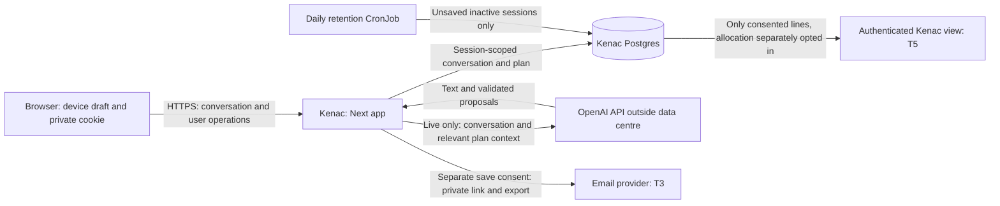

# Budget Buddy CSO review

T6 implementation, reviewed 14 October 2026. This is a control inventory and integration checklist, not a claim of legal certification. Frozen plan and session contracts are unchanged.

## Data flow

The journey says unsaved sessions stay on the device; server-side generation also requires server-side session context under the current contract. `/privacy` discloses both. T8 must reconcile the final browser persistence and server retention behavior. Device-only is not a promise we can make for live server-side sessions. Production hosting is planned for the Kenac data centre; a temporary pilot must name its real host. Administrators can technically read the database. Sales access is a different, limited projection, not an absolute barrier against database administrators.

## Controls and threats

| Threat | Mitigation | Implementation / remaining verification |
| --- | --- | --- |
| Prompt injection; invented prices; advisor accepting or sharing a line | Treat all model output as untrusted, schema-validate it and apply actor-authorized operations; keep pricing evidence mandatory | Frozen `src/lib/plan/ops.ts`; T1 agent/tool validation and T7 evals need integrated review. CSP does not prevent prompt injection. |
| Cross-session leakage or guessed identifiers | High-entropy cookie token, token-scoped lookup, explicit ownership checks on every operation/export; never take a session id from the body as authority | Frozen `src/lib/session/store.ts`; T3 routes/store and T5 exports must enforce ownership. In-memory store is only for local/demo, never two production replicas. |
| Session theft, XSS and clickjacking | Fresh random CSP nonce for each response, theme script nonce, no arbitrary inline scripts, self-hosted assets, denied framing, TLS, no caching of session/return responses | `next.config.ts`, `src/proxy.ts`, additive `src/app/layout.tsx` nonce. T3 must set Secure, HttpOnly, SameSite=Lax cookies, expire/rotate return credentials and avoid query/token access logs. |
| CSRF | Reject API mutation requests with a mismatched Origin; non-JSON bodies are rejected; same-origin CSP form actions | `src/proxy.ts`, `src/lib/security/request.ts`. Requests without Origin are allowed for API clients; T3 must keep SameSite cookies and route authorization. |
| Automated model spend / save and return-link abuse | 20 advisor turns/session and 60/IP/10 min; 10 save/return requests/IP/10 min; bounded bucket storage; Retry-After and calm copy | `src/lib/security/rate-limit.ts`, proxy; verified by unit and proxy tests. Shared save/return bucket is intentionally conservative. |
| Spoofed client IP | Ignore forwarding headers unless explicitly configured; validate IP syntax; ingress must overwrite trusted header and restrict direct pod access | `clientIp()` in `src/lib/security/request.ts`, `TRUSTED_IP_HEADER`. Unconfigured clients share an unknown-IP bucket, reducing availability rather than disabling protection. |
| JSON floods and slow uploads | Enforce 16,384 bytes including chunked bodies, reject wrong content type, five-second body-read deadline; 16 KB + 1 byte Next proxy buffer; ingress body cap | `checkJsonBody()` before route execution. Zod route schemas are still required from T1/T3/T5. Add upstream connection/request limits before public launch. |
| Scraping the Kenac sales view / unconsented allocation disclosure | Authenticate operator staff, return only explicitly shared fields, enforce allocation opt-in, honor withdrawals and audit accesses | T5 owns `/kenac` and shared-line projection; not yet present in this worktree. IP limits are not authorization. Require identity-provider/RBAC and audit integration before release. |
| PII or bearer credentials in logs | Fixed event and route allowlists, per-process keyed session hashes, omit nested data, message text, emails, names, tokens and exception strings | `src/lib/log.ts` and tests; proxy logs rejected requests only. No pre-existing API console.log calls exist in this worktree. T8 must replace route logging introduced by sibling workstreams. Never log raw `/r/*` paths at ingress/APM. |
| Forgotten unsaved data | Atomic `DELETE` with `savedAt IS NULL` and `updatedAt < cutoff`; 30-day inactivity policy; count-only output; daily job | `src/lib/security/retention.ts`, `scripts/retention.ts`, `pnpm retention`, `deploy/k8s/retention-cronjob.yaml`. Saved/active/boundary fixtures preserved. Daily schedule can lag threshold by one day. |
| Bad production configuration | Zod environment validation and redacted failures; live requires API key, database URL, HTTPS app URL; model configurable | `src/lib/env.ts`, config/proxy imports and container runtime entrypoint. Demo permits missing external services; health exposes missing dependencies accurately. |
| Pod compromise / overly broad credentials | Non-root uid 1001, no privilege escalation, read-only filesystem, dropped capabilities, no service account token, resource limits | Dockerfile and manifests. Kenac must provide network policy, DB TLS and least-privilege role, registry secret and managed credentials. |

## HTTP policy

- `Content-Security-Policy`: default/self, nonce+self for scripts, no script `unsafe-inline`; self-hosted fonts; self connections; object none; base/form self; frame ancestors none. Development alone permits script `unsafe-eval` and WebSocket connections for Next tooling. Inline styles remain permitted for existing chart/progress/motion style attributes; this exception does not permit inline scripts.
- `Strict-Transport-Security: max-age=31536000; includeSubDomains` (effective only over HTTPS).
- `X-Content-Type-Options: nosniff`.
- `Referrer-Policy: strict-origin-when-cross-origin`; private return paths use `no-referrer` to keep bearer links out of same-origin referrers.
- `Permissions-Policy: microphone=(self), camera=(), geolocation=()`.
- `X-Frame-Options: DENY`.
- `X-Powered-By` disabled; proxy responses `Cache-Control: private, no-store`; health `no-store`.

Nonces require request-time rendering. Cache Components / partial prerendering are disabled; the root reads headers, allowing Next's hydration/bootstrap scripts to receive the request nonce. Never cache HTML at ingress/CDN or reuse nonce-bearing shells. Any later theme script change must keep its nonce attribute. Next's normal client navigation is supported.

The limiter is in-memory, per process/replica; with two replicas effective limits can double, and restart resets buckets. This bounds a friendly pilot, not a distributed attack. Move to Redis with an atomic shared counter (or a centrally enforced ingress rate policy) before autoscaling, broader public access, stricter global cost guarantees or evidence of distributed abuse. No new dependency is introduced here. Keep OpenAI project spend controls enabled as a second boundary.

## Data policy and legal release gates

OpenAI policy verified against [official API data controls](https://developers.openai.com/api/docs/guides/your-data) on 14 October 2026: API data is not used for training unless the customer opts in; abuse monitoring content normally lasts up to 30 days, with legal/safety exceptions. Some features retain state; zero retention requires eligible account configuration and is not promised. T1/T8 must confirm request settings (including `store: false` where supported), model caching, actual context minimization and no provider-side persistent conversations. The page makes no claim that names are automatically removed: minimization under D5 remains a T1 integration gate. Saved contacts must not be sent to the model or sales without consent.

[Act published by POTRAZ](https://www.potraz.gov.zw/wp-content/uploads/2022/02/Data-Protection-Act-5-of-2021.pdf): sections 8–10 require necessary, fair, lawful, purpose-specific processing; proposed consent basis is section 10. TODO(legal): obtain Kenac confirmation of lawful basis, consent wording, international transfers, processor agreements, controller registration/licensing obligations, subject-rights procedure, incident reporting and the proposed privacy@kenac.co.zw mailbox. This is not legal advice or a completed compliance review.

TODO(legal/operations): define backup expiry, deletion after restore, encryption at rest/in transit, privileged-access audit, access review cadence, incident response owner and contact routing. Deleting the active session cannot immediately erase backups or provider retention; the page says so. Do not launch until the hosting wording names the actual location.

## Integration checklist for T8

- T2: link the permanent advisor footer to `/privacy`; validate device draft key names against DeletePlan's `bb-` cleanup, or centralize storage cleanup. Theme persistence must remain intact.
- T3: provide authenticated, idempotent `DELETE /api/session`, invalidate session/return credentials and remove associated sharing records. T6 intentionally does not edit T3-owned session routes. DeletePlan has confirmation, pending, success and failure states; it only clears browser drafts after a successful response.
- T3/T8: align retention with unsaved inactivity (`updatedAt`); enforce expiry on access and on local-device drafts so a delayed CronJob cannot resurrect expired content. Confirm explicit consent records and withdrawal audit, session token lifecycle and mailbox delivery configuration.
- T1/T3/T5: adopt `log()` for events, using session record id, never token; use the fixed route/event names. Measure actual handler duration in routes, not proxy time. Recheck API console statements after merge.
- T1/T8: enforce D5's minimum external context and provider retention configuration; check legal transfer decision. Apply model-independent plan/price/actor checks before persisted operations.
- T5: verify authenticated Kenac view and contact/field-level consent projection, withdrawal and no scraping bypass.
- T8/operations: build and run container against Postgres; run real retention fixtures including concurrent save; finalize image, TLS, domain, ingress trust, SMTP and ArgoCD targets. Scan dependencies/image and configure centralized abuse protection before expanding the pilot.
- CSO: sign off the legal/hosting/admin-access/backup gaps. This checklist is not signed off while integration controls remain unverified.
